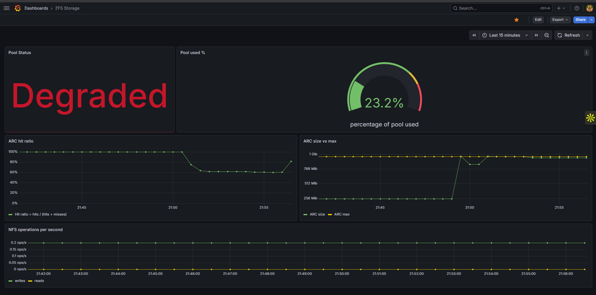
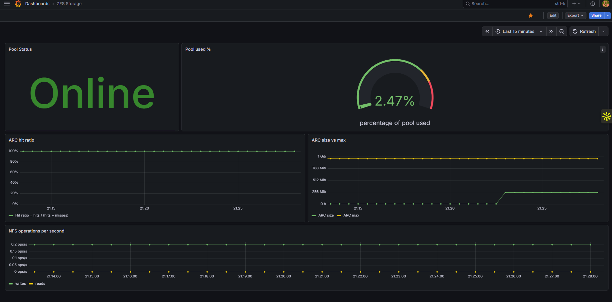
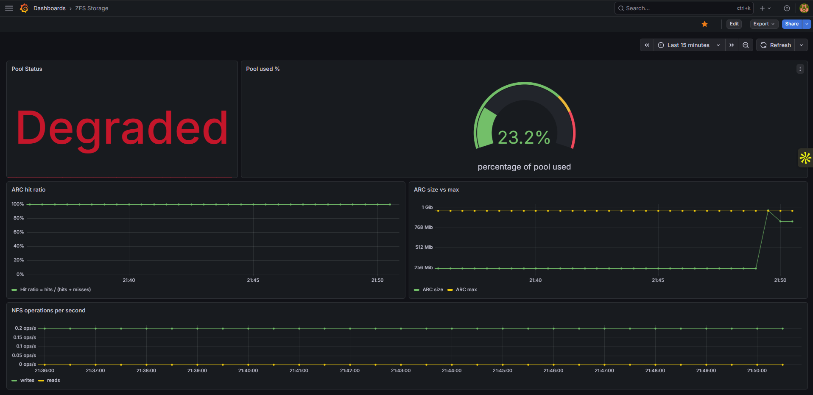
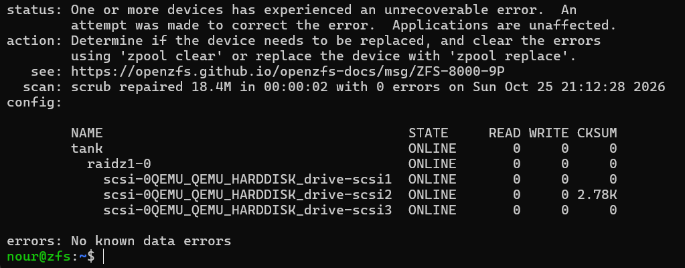
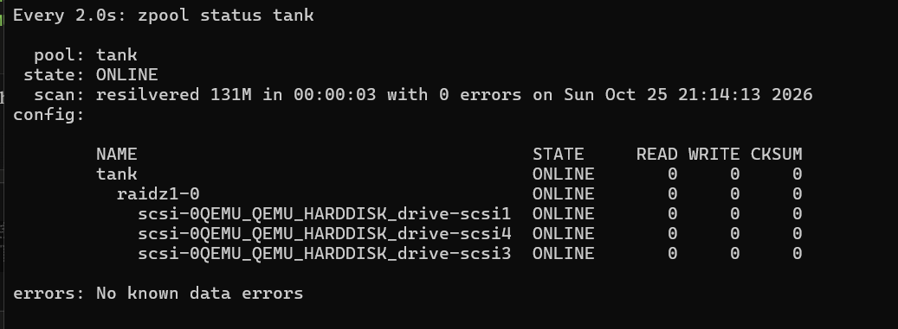
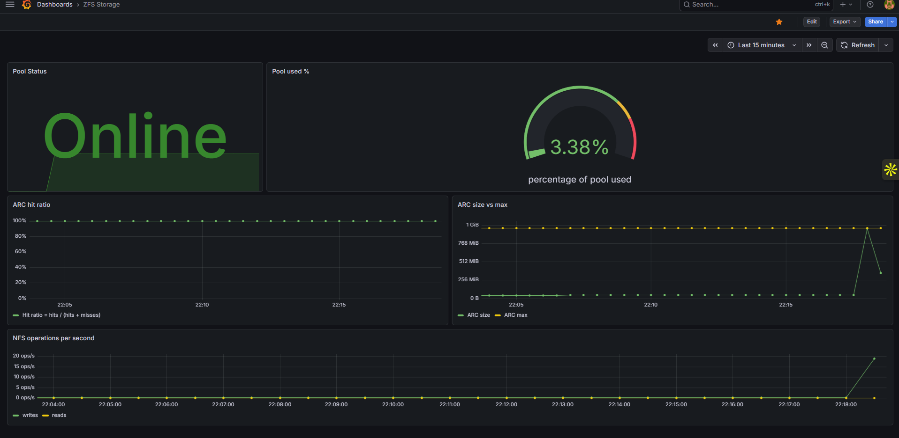

# zfs-nfs-exporter


A small Prometheus exporter in Rust for a ZFS storage server: pool health and capacity, ARC cache statistics, and NFS server activity.

I wrote it to learn Rust on something real. My homelab runs Kubernetes (k3s) on Proxmox, and I wanted a proper storage server behind it: a ZFS pool shared over NFS, with monitoring good enough to see what the storage is doing when things go wrong. Then I broke it on purpose to check that it does what it claims.



## The setup

```
Proxmox host
├── VM zfs-storage (Ubuntu 24.04)
│   ├── ZFS pool "tank": RAID-Z1 on 3 virtual disks, ARC capped at 1 GiB
│   │   └── dataset tank/k8s, lz4 compression ── NFSv4 ──┐
│   └── zfs-nfs-exporter on :9877 (systemd service)       │
└── VM k3s                                                │
    ├── pod zfs-writer ── PVC ── static NFS PV ───────────┘
    └── kube-prometheus-stack (Prometheus + Grafana)
```

The `zfs-writer` pod appends a timestamp to a log file every 5 seconds. It is a boring, predictable workload, which is exactly what makes it useful: if the storage hiccups, the log shows it.

## What it exports

| Metric | Type | Read from |
| --- | --- | --- |
| `zfs_pool_size_bytes{pool}` | gauge | `zpool list -Hp` |
| `zfs_pool_allocated_bytes{pool}` | gauge | `zpool list -Hp` |
| `zfs_pool_free_bytes{pool}` | gauge | `zpool list -Hp` |
| `zfs_pool_online{pool}` | gauge (1/0) | `zpool list -Hp` |
| `zfs_pool_health{pool,state}` | gauge | `zpool list -Hp` |
| `zfs_arc_size_bytes`, `zfs_arc_max_bytes` | gauge | `/proc/spl/kstat/zfs/arcstats` |
| `zfs_arc_hits_total`, `zfs_arc_misses_total` | counter | `/proc/spl/kstat/zfs/arcstats` |
| `nfsd_rpc_calls_total` | counter | `/proc/net/rpc/nfsd` |
| `nfsd_v4_read_ops_total`, `nfsd_v4_write_ops_total` | counter | `/proc/net/rpc/nfsd` |

If a source is missing (no ZFS, no NFS server), that part is skipped and the rest still works.

## Build and run

```bash
cargo test
cargo build --release
./target/release/zfs-nfs-exporter      # http://0.0.0.0:9877/metrics
```

On the storage server it runs as a systemd service, under a temporary unprivileged user with a read-only view of the system. It only reads, so that is all it gets.

```bash
sudo cp target/release/zfs-nfs-exporter /usr/local/bin/
sudo cp deploy/zfs-nfs-exporter.service /etc/systemd/system/
sudo systemctl daemon-reload
sudo systemctl enable --now zfs-nfs-exporter
```

## What is in the repo

| Path | Content |
| --- | --- |
| `src/main.rs` | The exporter and its unit tests |
| `deploy/zfs-nfs-exporter.service` | The systemd unit |
| `deploy/zfs-demo.yaml` | Static NFS PersistentVolume, PVC and the test pod |
| `deploy/prometheus-scrape-values.yaml` | Helm values that add the exporter to kube-prometheus-stack |
| `deploy/grafana-dashboard.json` | The Grafana dashboard, ready to import |
| `docs/` | Screenshots from the tests below |
| `.github/workflows/ci.yml` | CI: formatting, clippy, tests and a release build on every push |

## A few choices

- Only one dependency, `tiny_http`. The Prometheus text format is simple enough to write by hand, the binary stays around 1 MB, and I understand every line of it.
- The parsers are plain functions that take text and return data. That is why they can be unit-tested without a ZFS machine, and why only one function touches the system.
- The pool uses `/dev/disk/by-id` names, so it does not care if the disks are detected in a different order after a reboot.
- `ashift=12` is set explicitly when creating the pool rather than left to auto-detection, which virtual and older disks can get wrong.

## Testing it for real

Lab: one Proxmox VM with 2 vCPU and 3 GB of RAM, the ARC capped at 1 GiB, and RAID-Z1 on three 5 GB virtual disks (about 14.5 GB raw, 9.5 GB usable).

### The numbers add up

At rest, the NFS write rate sits at exactly 0.2 operations per second. The test pod writes once every 5 seconds, and 1 / 5 = 0.2. Seeing a number I can work out by hand on the dashboard was the moment I trusted the whole chain: pod, NFS, ZFS, exporter, Prometheus, Grafana.



Compression: with lz4 on, a copy of `/usr/share` came out at a compression ratio of 1.68x.

### Losing a disk

I took one of the three disks offline while the pod kept writing. The pool went DEGRADED within one scrape, and the NFS write rate did not move from 0.2 ops/s the whole time. The pod never noticed. RAID-Z1 kept serving everything from the two remaining disks and the parity. The only thing lost was the safety margin: a second failure at that point would have lost data.



### Silent corruption

This is the test I cared about most. With `dd`, I wrote 300 MB of random garbage straight onto one disk, behind ZFS's back, the way a failing disk would return bad data without reporting an error. Then I ran a scrub.

ZFS found 2,780 blocks on that disk whose checksums did not match, rebuilt them from parity, and repaired 18.4 MB in 2 seconds, with no data lost. A classic hardware RAID 5 would have handed that corrupted data back to applications without noticing, because it has no checksum to compare against.



### Replacing a disk

I then replaced the damaged disk with a new one (`zpool replace`). ZFS rebuilt 131 MB onto it in 3 seconds. It only copies the blocks that actually hold data, while a classic RAID rebuild copies the entire disk, empty space included.



### Pushing the cache past its limit

To watch the ARC under pressure, I wrote a 2 GB file, twice the size of the cache, then read it back at random positions for a minute.

| | Before | During and after |
| --- | --- | --- |
| Pool used (raw, parity included) | 2.5% | 23.2% |
| ARC size | about 240 MiB | climbed to the 1 GiB cap and stayed there |
| ARC hit ratio | 100% | about 62% during the random reads, about 82% shortly after |

The ARC only grew as data moved through it: the 1 GiB limit is a ceiling, not memory reserved up front. With a 2 GB file and a 1 GiB cache, about half of the random reads have to go to disk. The hit ratio landed a bit above 50% because ZFS metadata and recently reread blocks also count as hits. I used random reads on purpose: on sequential reads, ZFS prefetches ahead and hides most of the misses. The pool was still degraded during this run, which made no difference to the result.

### Writing through NFS

Finally, a 1 GB write from the k3s VM through the NFS share. The write rate on the dashboard jumped from the usual 0.2 to around 20 operations per second.



## What I took away from it

- RAID-Z has no write hole because of copy-on-write: ZFS never overwrites a block in place, so data and parity cannot fall out of sync after a crash.
- DEGRADED is not DOWN. The pool kept serving the pod with a disk missing; what I lost was the margin, not the service.
- Checksums are what make ZFS different from classic RAID. Parity alone can rebuild data, but only checksums tell you which copy is wrong.
- Check the real number before trusting a chart. My ARC size panel first looked stuck at zero: the value was 5.8 MiB on an axis that went up to 1 GiB, so less than a pixel high.
- On the Rust side: borrowing (`&str` in the parsers, owned `String` in the structs), `Option` and `Result` instead of nulls and exceptions, and keeping I/O away from the logic so it stays testable.
